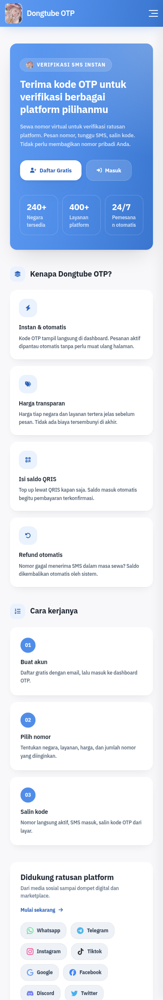
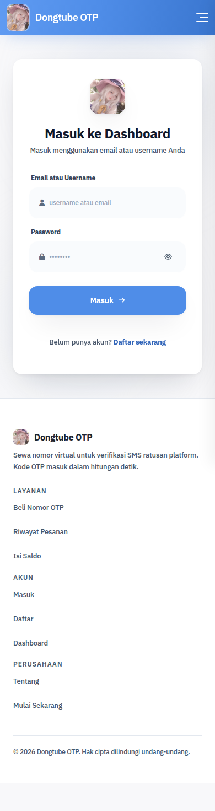
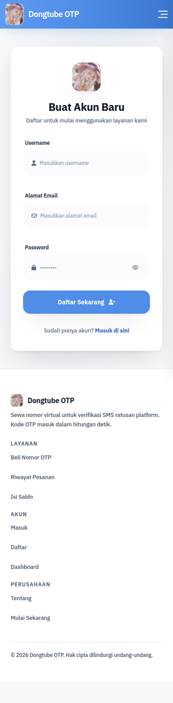
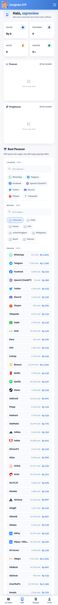
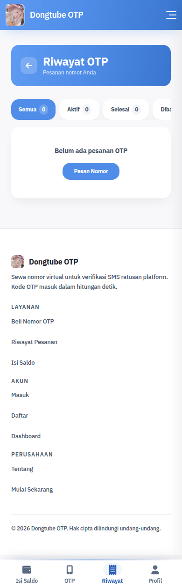
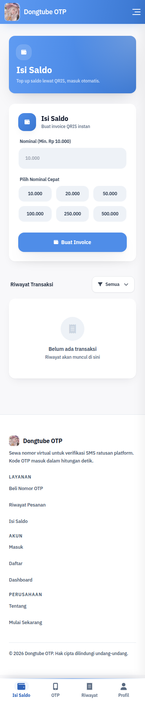
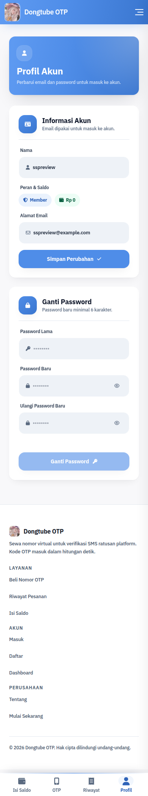
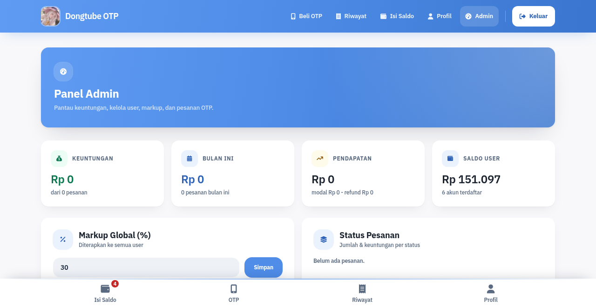

# Dongtube OTP

Website sewa nomor virtual untuk verifikasi SMS. Pembeli memilih layanan dan negara, kode OTP masuk ke dashboard dalam hitungan detik, dan saldo refund otomatis kalau kode tidak pernah sampai.

Instance yang berjalan sekarang: [https://dongtube-web1.vercel.app](https://dongtube-web1.vercel.app)

Kodenya satu proses Node.js: Express dengan template EJS yang dirender di server, tanpa build step. Semua data, termasuk user, pesanan, deposit, dan sesi, dibaca dan ditulis lewat API DongtubeDB dari [Dongtube Payment](https://payment.dongtube.cyou), tanpa file database lokal dan tanpa penyimpanan cadangan. Katalog layanan dan invoice QRIS diambil dari API Dongtube Payment yang sama. Basis kode yang dipakai di VPS dan Vercel sama persis, tanpa layanan tambahan di VPS.

## Tampilan

Semua cuplikan diambil dari instance yang berjalan. Layar HP kecuali panel admin.

### Beranda



### Masuk dan daftar





### Dashboard beli OTP



### Riwayat, isi saldo, profil







### Panel admin



## Fitur

- Katalog ratusan layanan dengan pencarian layanan, negara, dan produk.
- Pesanan aktif sendiri; status nomor dan kode OTP diperbarui tanpa muat ulang halaman.
- Refund otomatis untuk nomor yang tidak menerima SMS sampai masa sewa habis.
- Riwayat pesanan dengan filter status.
- Isi saldo QRIS lewat Dongtube Payment: nominal cepat dan riwayat transaksi.
- Profil: ubah email dan ganti password.
- Panel admin: markup global, saldo user, edit dan hapus akun, ringkasan keuntungan, pesanan terbaru.
- Responsif dengan navigasi bawah untuk layar HP.

## Kebutuhan

- Node.js 18 atau lebih baru, dijalankan dan diuji di Node 24.
- Layanan [Dongtube Payment](https://payment.dongtube.cyou) yang berjalan, untuk katalog layanan, pembayaran QRIS, dan database DongtubeDB.
- API key Dongtube Payment yang berlaku, dipakai untuk katalog dan untuk akses database.
- nginx di depan proses untuk produksi.
- Akun Vercel kalau dijalankan sebagai fungsi serverless.

## Menjalankan di lokal

1. Ambil kode dan pasang dependensi:

   ```bash
   git clone https://github.com/hanzywaifu-coder/dongtube-web.git
   cd dongtube-web
   npm install
   ```

2. Salin template environment:

   ```bash
   cp .env.example .env
   ```

3. Isi `.env`. Isi minimal `SESSION_SECRET` dengan nilai acak dan `PAY2_API_KEY`. Satu API key itu dipakai untuk katalog, invoice, dan database, sedangkan base URL Dongtube Payment sudah dikodekan di `lib/pay2.js`. Untuk membuat SESSION_SECRET:

   ```bash
   openssl rand -hex 32
   ```

4. Jalankan:

   ```bash
   npm start
   ```

   Lalu buka [http://localhost:3002](http://localhost:3002). Tabel `web_*` dibuat sendiri lewat API saat boot pertama, jadi tidak ada langkah menyiapkan file database.

5. Masuk sebagai admin memakai `ADMIN_USERNAME` dan `ADMIN_PASSWORD` dari `.env`. Boot pertama membuat akun admin otomatis. Kalau `ADMIN_PASSWORD` kosong, password sementara saat boot pertama adalah `admin123`.

## Variabel environment

| Variabel | Wajib | Keterangan |
| --- | --- | --- |
| PORT | tidak | Port HTTP internal, default 3002. Tidak dipakai di Vercel. |
| SESSION_SECRET | ya | Kunci cookie sesi, buat dengan `openssl rand -hex 32`. |
| SITE_NAME | tidak | Nama situs di judul dan footer, default Dongtube OTP. |
| PAY2_API_KEY | ya | Satu API key yang dipakai untuk katalog, invoice, dan database DongtubeDB. |
| PAY2_API_KEY | ya | API key Dongtube Payment untuk katalog layanan, invoice QRIS, dan seluruh akses database lewat API DongtubeDB. |
| DEFAULT_MARKUP_PERCENT | tidak | Markup global awal dalam persen, default 30. |
| MIN_DEPOSIT | tidak | Nominal minimum invoice isi saldo, default 10000. |
| DEFAULT_COUNTRY | tidak | Kode negara default di katalog, default 7. |
| ADMIN_USERNAME | tidak | Nama akun admin, default admin. |
| ADMIN_EMAIL | tidak | Email admin. Kalau kosong, menjadi `ADMIN_USERNAME@dongtube.local`. |
| ADMIN_PASSWORD | ya | Password admin. Kosong berarti `admin123` saat boot pertama. Mengubah nilai ini di `.env` menekan ulang password ke database saat restart. |

Tidak ada variabel untuk file database maupun driver database. Seluruh akses database berjalan lewat satu endpoint API dengan dua variabel Dongtube Payment di atas.

## Deploy ke VPS

### PM2

```bash
npm ci
pm2 start server.js --name dongtube-web
pm2 save
pm2 startup
```

Ikuti perintah yang dicetak `pm2 startup` supaya service ikut hidup lagi setelah reboot.

### systemd

Berkas `/etc/systemd/system/dongtube-web.service`:

```ini
[Unit]
Description=Dongtube OTP website
After=network.target

[Service]
Type=simple
WorkingDirectory=/opt/dongtube-web
EnvironmentFile=/opt/dongtube-web/.env
ExecStart=/usr/bin/node server.js
Restart=on-failure
User=www-data

[Install]
WantedBy=multi-user.target
```

User di `User=` cukup punya akses baca tulis ke folder proyek. Tidak ada file database yang perlu dibagikan ke proses.

```bash
systemctl daemon-reload
systemctl enable --now dongtube-web
```

### nginx

```nginx
server {
    listen 80;
    server_name otp.example.com;

    location / {
        proxy_pass http://127.0.0.1:3002;
        proxy_http_version 1.1;
        proxy_set_header Host $host;
        proxy_set_header X-Real-IP $remote_addr;
        proxy_set_header X-Forwarded-For $proxy_add_x_forwarded_for;
        proxy_set_header X-Forwarded-Proto $scheme;
    }
}
```

Aplikasi sudah menyetel trust proxy, jadi cookie Secure terpasang sendiri begitu ada HTTPS di depan. Sertifikatnya diterbitkan dengan:

```bash
certbot --nginx -d otp.example.com
```

## Deploy ke Vercel

Di Vercel tidak ada layanan tambahan: yang dibundel hanya kode, view, dan berkas statis lewat `includeFiles` di `vercel.json`, sedangkan database diakses lewat API DongtubeDB dari origin Dongtube Payment, sama seperti VPS. Karena itu tidak ada driver database, file lokal, atau layanan antre yang perlu dipasang di VPS.

Push repo ini ke GitHub, lalu import di dashboard Vercel dengan framework Other. Environment variables yang diisi:

- `SESSION_SECRET`, `PAY2_API_KEY`, `ADMIN_USERNAME`, `ADMIN_PASSWORD`: sama seperti VPS.
- `SITE_NAME`, `DEFAULT_MARKUP_PERCENT`, `MIN_DEPOSIT`, `DEFAULT_COUNTRY`: opsional, sama seperti VPS.

`PORT` tidak dipakai di Vercel. Sesi berjalan lewat API sejak boot pertama, jadi tidak ada pengaturan tambahan dan tiap instance memakai tabel `web_sessions` yang sama.

`server.js` diekspor berbentuk function agar sah sebagai entry backend loader Vercel, lalu melayani semua path tanpa konfigurasi routing tambahan. Internal rewrite sengaja tidak dipakai karena mengubah respons redirect 302 menjadi 307, dan 307 membuat browser mengulang POST yang sama sehingga formulir gagal login bisa berputar tanpa henti. Views dan gambar ikut masuk bundel fungsi lewat `includeFiles`.

Terakhir, deploy lewat tombol di dashboard atau `vercel --prod`. Dua hal yang beda dari VPS: rate limit memakai memori per instance sehingga batasnya berlaku per proses, bukan global, dan boot gagal non-koneksi dibalas 503 oleh fungsi alih-alih menghentikan proses.

## Database

- Seluruh akses database lewat satu endpoint API DongtubeDB, `https://payment.dongtube.cyou/db/api/query`, dengan host yang dikodekan di `lib/pay2.js` dan memakai `PAY2_API_KEY`. Tidak ada driver lokal, tidak ada file database, dan tidak ada cadangan lain. Kalau API-nya tidak terjangkau, memang tidak ada tempat lain untuk datang.
- Tabel `web_users`, `web_orders`, `web_deposits`, `web_sessions`, dan `web_settings` dibuat otomatis lewat API saat boot pertama.
- Sesi disimpan di tabel `web_sessions` lewat API, jadi setiap sesi tercatat di database, bukan di memori proses.
- Penanda bahwa database pernah terisi juga disimpan di tabel `web_settings`. Mengganti instance database cukup dengan mengganti environment lalu restart, tanpa menghapus berkas penanda.
- Kalau koneksi ke API gagal, entah jaringan mati, timeout, respons bukan JSON, atau server membalas status selain 200 sukses dan 400, semua permintaan ditolak dengan halaman perawatan 503, termasuk berkas statis. Proses tetap berjalan dan mengulang percobaan saat permintaan masuk, paling cepat tiap 3 detik, sampai ada percobaan koneksi yang berhasil. Setelah itu permintaan berikutnya jalan normal kembali.
- Query yang salah dibalas 400 dan dilempar apa adanya sebagai kesalahan pemakaian, tanpa menandai koneksi sebagai putus.
- Setiap panggilan API berbatas waktu, 5 detik untuk database dan 8 detik untuk katalog serta pesanan, dengan satu kali ulang tanpa jeda khusus gangguan jaringan. Menggantung tidak pernah dibiarkan berjalan: berujung halaman perawatan yang jujur, bukan fungsi Vercel yang dibunuh sebelum sempat membalas.
- Boot gagal karena SQL salah atau konfigurasi bukan karena koneksi dianggap fatal: di VPS proses langsung berhenti dan disalakan lagi oleh systemd, di Vercel fungsi membalas 503.

## Keamanan produksi

- Ganti `SESSION_SECRET` dan `ADMIN_PASSWORD` sebelum situs dibuka ke publik.
- Form login dan pendaftaran dibatasi rate limit per IP,20 dan 10 percobaan tiap 5 menit.
- Password disimpan sebagai hash scrypt dengan salt acak.
- Cookie sesi memakai httpOnly dan sameSite lax, dengan Secure otomatis di belakang HTTPS.

## Struktur berkas

```text
dongtube-web/
├── server.js            rute, sesi, order, deposit, admin, gerbang perawatan, entry VPS dan Vercel
├── lib/
│   ├── db.js            klien API DongtubeDB, seluruh akses database lewat HTTP
│   ├── pay2.js          klien API Dongtube Payment dengan cache
│   ├── session-store.js sesi di tabel web_sessions lewat API
│   ├── otp-icons.js     ikon layanan
│   └── otp-icons-map.js pemetaan ikon layanan
├── views/
│   ├── layouts/         kerangka halaman
│   ├── partials/        bagian yang dipakai lintas halaman
│   └── pages/           landing, login, register, otp, orders, deposit, profile, admin
├── public/img/          logo dan ikon layanan
├── docs/preview/        cuplikan halaman untuk README
├── .env.example         template environment
├── vercel.json          routing dan konfigurasi fungsi Vercel
└── package.json
```

## Lisensi

MIT, lihat berkas `LICENSE`.
